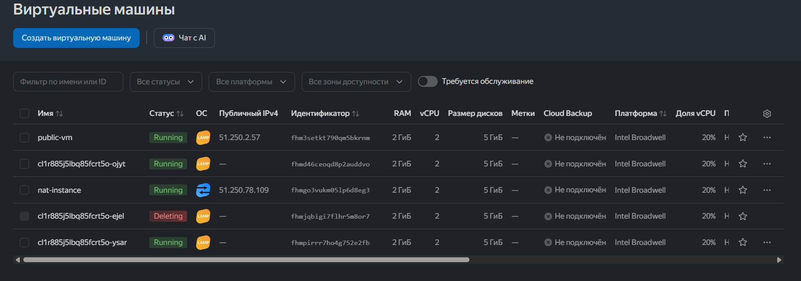
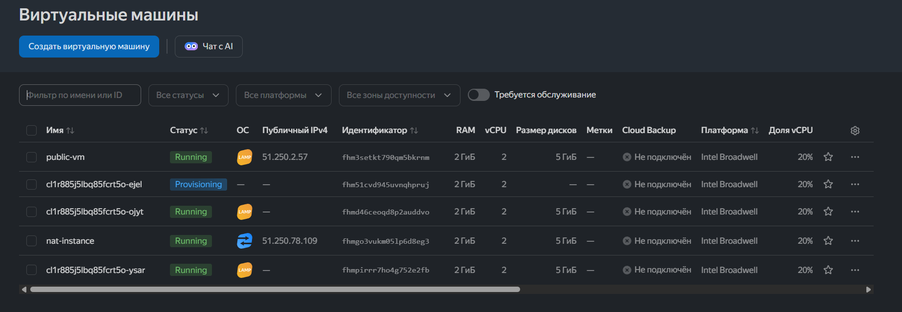

# Домашнее задание к занятию «Вычислительные мощности. Балансировщики нагрузки»  — Рыбянцев Павел

### Цель проекта
Развернуть отказоустойчивую инфраструктуру в Yandex Cloud с использованием Terraform.
Контур включает в себя веб-серверы LAMP, объединенные в Instance Group, сетевой балансировщик нагрузки (Network Load Balancer) для распределения трафика и Object Storage для хранения статических файлов.

---

## Архитектура и сетевая топология
Инфраструктура полностью описывается кодом и разворачивается автоматически. В целях безопасности целевые веб-серверы группы изолированы от прямого доступа из интернета (`nat = false`).

*   **VPC Network:** `vpc-network`
*   **Public Subnet:** `192.168.10.0/24` — содержит `nat-instance`, бастионную `public-vm` и целевую группу балансировщика.
*   **Private Subnet:** `192.168.20.0/24` — закрытый контур (задел под бэкенд и БД в следующих ДЗ).
*   **NAT Instance:** обеспечивает выход в интернет для машин из инстанс-группы (необходимо для работы менеджера пакетов и обновлений).
*   **Instance Group:** 3 виртуальные машины с образом LAMP. Размер дисков оптимизирован под лимиты квот (5 ГБ HDD на машину).
*   **Network Load Balancer:** распределяет входящий трафик (порт 80) по кругу (Round Robin) между живыми машинами группы.
*   **Object Storage:** публичный бакет S3 для хранения изображений.

---


## Проверка работоспособности и отказоустойчивости

### Шаг 1. Развертывание
Поднимаем инфрастурктуру:  `terraform apply -auto-approve`:

```bash
Apply complete! Resources: 11 added, 0 changed, 0 destroyed.
```

outputs:
```
====================================================================

1. Сетевой балансировщик (Network Load Balancer) успешно создан.
   Открыть веб-страницу группы LAMP в браузере:
   http://51.250.68.137/

2. Прямая ссылка на файл в Object Storage бакете:
   https://shishelm-bucket-2026-11.storage.yandexcloud.net/screenshot.png
```

### Шаг 2. Проверка веб-страницы через балансировщик
При переходе по публичному IP-адресу сетевого балансировщика открывается кастомная страница. Текст отображается корректно, а логотип успешно подтягивается по прямой ссылке из S3:


### Шаг 3. Имитация аварии (Тест Fault Tolerance)
Через веб-консоль Yandex Cloud принудительно останавливается одна из виртуальных машин внутри `lamp-instance-group`.

*   Балансировщик фиксирует статус `unhealthy` для упавшего хоста и мгновенно перенаправляет 100% трафика на две оставшиеся живые машины. Сайт продолжает работать без прерывания сессии пользователя.

*   Сервис Instance Group фиксирует отклонение от целевого размера группы (2 вместо 3) и автоматически инициирует создание нового инстанса взамен упавшего.



